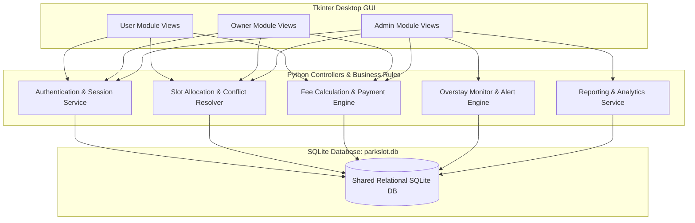
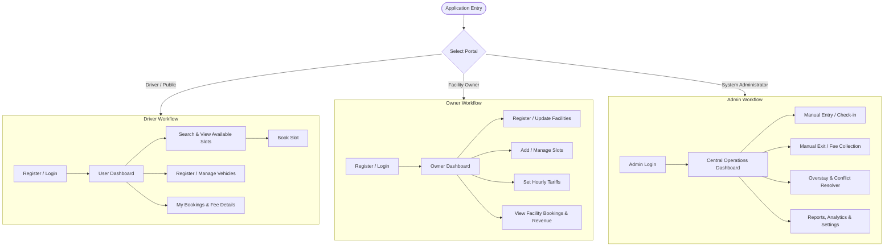
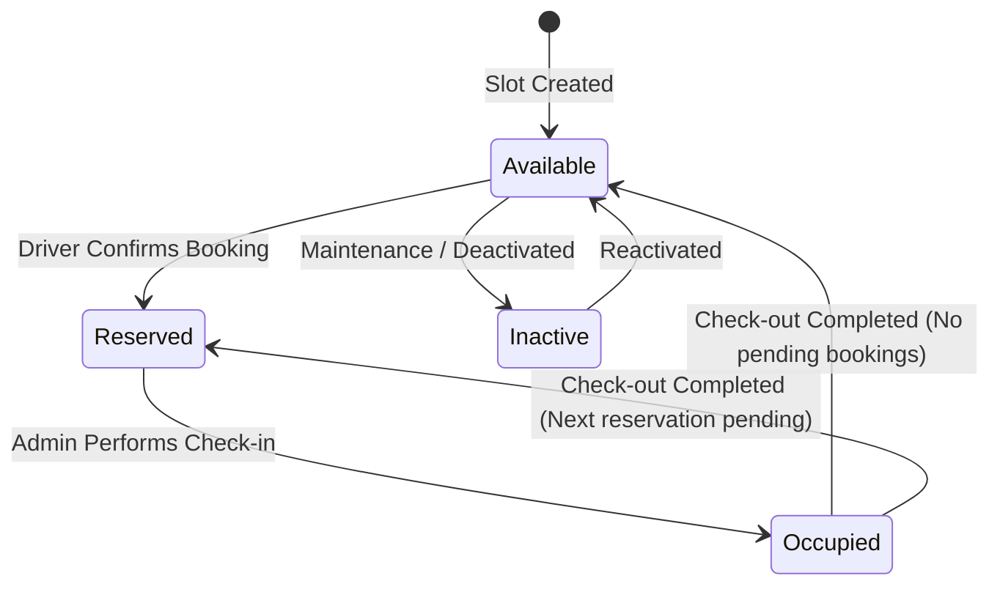
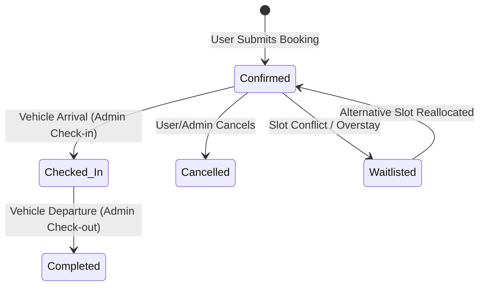
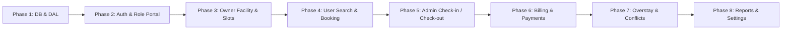

# PARKSLOT — Systematised Vehicular Parking Space Identification, Allocation & Utilisation Management System

> **Document Type:** AI-Readable Master Software Requirements Specification (SRS) & Architecture Blueprint  
> **Target AI Agent:** Antigravity AI  
> **Primary Technology Stack:** Python 3.10+, Tkinter (GUI / CustomTkinter compatible), SQLite3  
> **Architecture Pattern:** Modular Layered Desktop Architecture (UI Views, Business Logic / Controllers, SQLite Repository / DAL)

---

## Table of Contents
1. [Project Overview & System Architecture](#1-project-overview--system-architecture)
2. [Unified SQLite Database Schema (DDL)](#2-unified-sqlite-database-schema-ddl)
3. [User Roles & Module Separation](#3-user-roles--module-separation)
4. [User Module Specification (11 Screens)](#4-user-module-specification)
5. [Owner Module Specification (10 Screens)](#5-owner-module-specification)
6. [Administrator Module Specification (13 Screens)](#6-administrator-module-specification)
7. [Core Business Logic & State Machines](#7-core-business-logic--state-machines)
8. [Recommended Project Directory Structure](#8-recommended-project-directory-structure)
9. [Step-by-Step AI Implementation Roadmap](#9-step-by-step-ai-implementation-roadmap)
10. [Validation, Security & Test Cases](#10-validation-security--test-cases)

---

## 1. Project Overview & System Architecture

### 1.1 Objective
ParkSlot is an integrated desktop management system designed to streamline vehicular parking operations across three key stakeholders:
1. **Regular Users (Drivers):** Register vehicles, find parking slots by location/type, reserve slots, and track parking duration and fees.
2. **Parking Facility Owners:** Register facilities, define parking capacities, configure vehicle-type tariffs, and track slot occupancy and revenue.
3. **System Administrators:** Monitor overall parking operations via a real-time dashboard, execute manual vehicle check-ins/check-outs, monitor overstayed sessions, resolve reservation conflicts, and generate audit reports.

### 1.2 Technology Decisions
- **Programming Language:** Python 3.10+
- **Frontend / Graphical Interface:** Tkinter (standard library, optionally styled with `ttk` or `customtkinter`)
- **Persistence Layer:** SQLite3 (local relational database `parkslot.db`)
- **Optional Extensions:** `pandas` (for reporting/exports), `matplotlib` (for visual occupancy charts), `qrcode` / `opencv-python` (optional webcam/QR verification)
- **Deployment Mode:** Standalone or shared local networked SQLite file. No web server / external daemon strictly required for base deployment.



---

## 2. Unified SQLite Database Schema (DDL)

All three modules operate on a shared relational schema with strict foreign key constraints and transactional integrity.

```sql
PRAGMA foreign_keys = ON;

-- 1. Admins Table
CREATE TABLE IF NOT EXISTS admins (
    admin_id INTEGER PRIMARY KEY AUTOINCREMENT,
    username TEXT UNIQUE NOT NULL,
    email TEXT UNIQUE NOT NULL,
    password_hash TEXT NOT NULL,
    status TEXT CHECK(status IN ('Active', 'Inactive')) DEFAULT 'Active',
    created_at TIMESTAMP DEFAULT CURRENT_TIMESTAMP
);

-- 2. Owners Table
CREATE TABLE IF NOT EXISTS owners (
    owner_id INTEGER PRIMARY KEY AUTOINCREMENT,
    full_name TEXT NOT NULL,
    email TEXT UNIQUE NOT NULL,
    phone_number TEXT NOT NULL,
    username TEXT UNIQUE NOT NULL,
    password_hash TEXT NOT NULL,
    account_status TEXT CHECK(account_status IN ('Active', 'Inactive', 'Suspended')) DEFAULT 'Active',
    created_at TIMESTAMP DEFAULT CURRENT_TIMESTAMP
);

-- 3. Users Table (Drivers)
CREATE TABLE IF NOT EXISTS users (
    user_id INTEGER PRIMARY KEY AUTOINCREMENT,
    full_name TEXT NOT NULL,
    email TEXT UNIQUE NOT NULL,
    phone_number TEXT NOT NULL,
    username TEXT UNIQUE NOT NULL,
    password_hash TEXT NOT NULL,
    account_status TEXT CHECK(account_status IN ('Active', 'Inactive', 'Suspended')) DEFAULT 'Active',
    created_at TIMESTAMP DEFAULT CURRENT_TIMESTAMP
);

-- 4. Vehicles Table
CREATE TABLE IF NOT EXISTS vehicles (
    vehicle_id INTEGER PRIMARY KEY AUTOINCREMENT,
    user_id INTEGER NOT NULL,
    registration_number TEXT UNIQUE NOT NULL,
    vehicle_type TEXT CHECK(vehicle_type IN ('Car', 'Bike', 'Other')) NOT NULL,
    model TEXT,
    colour TEXT,
    created_at TIMESTAMP DEFAULT CURRENT_TIMESTAMP,
    FOREIGN KEY (user_id) REFERENCES users(user_id) ON DELETE CASCADE
);

-- 5. Parking Facilities Table
CREATE TABLE IF NOT EXISTS parking_facilities (
    facility_id INTEGER PRIMARY KEY AUTOINCREMENT,
    owner_id INTEGER,
    name TEXT NOT NULL,
    location TEXT NOT NULL,
    contact_number TEXT NOT NULL,
    total_slots INTEGER NOT NULL DEFAULT 0,
    opening_time TEXT DEFAULT '00:00',
    closing_time TEXT DEFAULT '23:59',
    created_at TIMESTAMP DEFAULT CURRENT_TIMESTAMP,
    FOREIGN KEY (owner_id) REFERENCES owners(owner_id) ON DELETE SET NULL
);

-- 6. Parking Rates Table
CREATE TABLE IF NOT EXISTS parking_rates (
    rate_id INTEGER PRIMARY KEY AUTOINCREMENT,
    facility_id INTEGER NOT NULL,
    vehicle_type TEXT CHECK(vehicle_type IN ('Car', 'Bike', 'Other')) NOT NULL,
    rate_per_hour REAL NOT NULL,
    updated_at TIMESTAMP DEFAULT CURRENT_TIMESTAMP,
    UNIQUE(facility_id, vehicle_type),
    FOREIGN KEY (facility_id) REFERENCES parking_facilities(facility_id) ON DELETE CASCADE
);

-- 7. Parking Slots Table
CREATE TABLE IF NOT EXISTS parking_slots (
    slot_id INTEGER PRIMARY KEY AUTOINCREMENT,
    facility_id INTEGER NOT NULL,
    slot_number TEXT NOT NULL,
    vehicle_type TEXT CHECK(vehicle_type IN ('Car', 'Bike', 'Other')) NOT NULL,
    floor_zone TEXT DEFAULT 'Ground',
    current_status TEXT CHECK(current_status IN ('Available', 'Reserved', 'Occupied', 'Inactive')) DEFAULT 'Available',
    UNIQUE(facility_id, slot_number),
    FOREIGN KEY (facility_id) REFERENCES parking_facilities(facility_id) ON DELETE CASCADE
);

-- 8. Bookings Table
CREATE TABLE IF NOT EXISTS bookings (
    booking_id INTEGER PRIMARY KEY AUTOINCREMENT,
    user_id INTEGER NOT NULL,
    vehicle_id INTEGER NOT NULL,
    slot_id INTEGER NOT NULL,
    booking_date TEXT NOT NULL,
    start_time TEXT NOT NULL,
    end_time TEXT NOT NULL,
    booking_status TEXT CHECK(booking_status IN ('Pending', 'Confirmed', 'Cancelled', 'Checked-in', 'Completed', 'Waitlisted')) DEFAULT 'Confirmed',
    cancellation_reason TEXT,
    created_at TIMESTAMP DEFAULT CURRENT_TIMESTAMP,
    FOREIGN KEY (user_id) REFERENCES users(user_id),
    FOREIGN KEY (vehicle_id) REFERENCES vehicles(vehicle_id),
    FOREIGN KEY (slot_id) REFERENCES parking_slots(slot_id)
);

-- 9. Parking Sessions Table (Check-in to Check-out Lifecycle)
CREATE TABLE IF NOT EXISTS parking_sessions (
    session_id INTEGER PRIMARY KEY AUTOINCREMENT,
    booking_id INTEGER NOT NULL,
    actual_entry TIMESTAMP NOT NULL,
    actual_exit TIMESTAMP,
    session_status TEXT CHECK(session_status IN ('Active', 'Closed', 'Overdue')) DEFAULT 'Active',
    created_at TIMESTAMP DEFAULT CURRENT_TIMESTAMP,
    FOREIGN KEY (booking_id) REFERENCES bookings(booking_id)
);

-- 10. Fees & Payments Table
CREATE TABLE IF NOT EXISTS fees_payments (
    payment_id INTEGER PRIMARY KEY AUTOINCREMENT,
    session_id INTEGER NOT NULL,
    duration_hours REAL NOT NULL,
    rate_applied REAL NOT NULL,
    amount REAL NOT NULL,
    payment_status TEXT CHECK(payment_status IN ('Pending', 'Paid', 'Waived')) DEFAULT 'Paid',
    method TEXT CHECK(method IN ('Cash', 'Card', 'UPI', 'Manual Verification')) DEFAULT 'Cash',
    paid_at TIMESTAMP DEFAULT CURRENT_TIMESTAMP,
    FOREIGN KEY (session_id) REFERENCES parking_sessions(session_id)
);

-- 11. Overstay Events Table
CREATE TABLE IF NOT EXISTS overstay_events (
    event_id INTEGER PRIMARY KEY AUTOINCREMENT,
    session_id INTEGER NOT NULL,
    detected_at TIMESTAMP DEFAULT CURRENT_TIMESTAMP,
    overdue_duration_minutes INTEGER NOT NULL,
    resolution_status TEXT CHECK(resolution_status IN ('Pending', 'Notified', 'Resolved')) DEFAULT 'Pending',
    notes TEXT,
    FOREIGN KEY (session_id) REFERENCES parking_sessions(session_id)
);

-- 12. Slot Reallocations Table
CREATE TABLE IF NOT EXISTS slot_reallocations (
    reallocation_id INTEGER PRIMARY KEY AUTOINCREMENT,
    booking_id INTEGER NOT NULL,
    old_slot_id INTEGER NOT NULL,
    new_slot_id INTEGER NOT NULL,
    reason TEXT,
    changed_at TIMESTAMP DEFAULT CURRENT_TIMESTAMP,
    FOREIGN KEY (booking_id) REFERENCES bookings(booking_id),
    FOREIGN KEY (old_slot_id) REFERENCES parking_slots(slot_id),
    FOREIGN KEY (new_slot_id) REFERENCES parking_slots(slot_id)
);

-- 13. Waitlist Table
CREATE TABLE IF NOT EXISTS waitlist (
    waitlist_id INTEGER PRIMARY KEY AUTOINCREMENT,
    booking_id INTEGER NOT NULL,
    requested_start TEXT NOT NULL,
    requested_end TEXT NOT NULL,
    queue_status TEXT CHECK(queue_status IN ('Waiting', 'Promoted', 'Expired', 'Cancelled')) DEFAULT 'Waiting',
    created_at TIMESTAMP DEFAULT CURRENT_TIMESTAMP,
    FOREIGN KEY (booking_id) REFERENCES bookings(booking_id)
);

-- 14. Admin Settings Table
CREATE TABLE IF NOT EXISTS admin_settings (
    setting_key TEXT PRIMARY KEY,
    setting_value TEXT NOT NULL,
    updated_at TIMESTAMP DEFAULT CURRENT_TIMESTAMP
);

-- Default Settings Seed
INSERT OR IGNORE INTO admin_settings (setting_key, setting_value) VALUES 
('overstay_grace_period_mins', '15'),
('default_hourly_rate_car', '30.0'),
('default_hourly_rate_bike', '15.0'),
('system_contact_email', 'admin@parkslot.com');
```

---

## 3. User Roles & Module Separation



---

## 4. User Module Specification

### 4.1 Screen List & Navigation

| No. | Screen Name | Priority | Purpose |
|:---|:---|:---|:---|
| U-01 | Welcome / Home Page | Basic | Entry portal for regular users |
| U-02 | User Registration Page | Required | Create a new user account |
| U-03 | User Login Page | Required | Authenticate existing user |
| U-04 | Forgot / Reset Password Page | Optional | Recover account via email verification |
| U-05 | User Dashboard | Required | Main hub displaying statistics and menu shortcuts |
| U-06 | My Profile Page | Recommended | View and update profile information |
| U-07 | Vehicle Management Page | Required | Register, update, and remove vehicles |
| U-08 | Available Parking Slots Page | Required | Search and filter slots by location & vehicle type |
| U-09 | Slot Booking Page | Required | Reserve slot and calculate estimated fee |
| U-10 | My Bookings Page | Required | View upcoming, active, and past reservations |
| U-11 | Fee Details Page | Required | Detailed breakdown of duration, rate, and fee |

### 4.2 Screen Details

#### U-01: Welcome / Home Page
- **Elements:** Logo, App Title ("ParkSlot"), Subtitle ("Welcome to ParkSlot - Parking Made Easy!"), Description.
- **Actions:**
  - `[ Login ]` → Navigates to U-03 User Login.
  - `[ Register ]` → Navigates to U-02 User Registration.
  - `[ Exit ]` → Exits application.

#### U-02: User Registration Page
- **Fields:** Full Name, Email, Phone Number, Username, Password, Confirm Password.
- **Validation:**
  - All fields mandatory.
  - Email format validation.
  - Username and Email uniqueness check against `users` table.
  - `password == confirm_password` check.
  - Passwords stored as SHA-256 or bcrypt hash.
- **Actions:** `[ Register ]`, `[ Clear ]`, `[ Back to Login ]`.
- **Target Navigation:** Successful registration displays confirmation popup and navigates to U-03.

#### U-03: User Login Page
- **Fields:** Username / Email, Password (masked).
- **Actions:** `[ Login ]`, `[ Forgot Password ]`, `[ Create Account ]`, `[ Back ]`.
- **Validation:** Hash match against `users.password_hash`. Rejects inactive/suspended accounts.
- **Target Navigation:** On success → U-05 User Dashboard.

#### U-04: Forgot / Reset Password Page
- **Fields:** Registered Email Address, New Password, Confirm New Password.
- **Actions:** `[ Verify Account ]`, `[ Reset Password ]`, `[ Back to Login ]`.
- **Logic:** Verifies email exists in `users`, updates `password_hash`.

#### U-05: User Dashboard
- **Display Metrics:**
  - Welcome banner: `"Welcome, {user_full_name}!"`
  - Registered Vehicles count
  - Available Parking Slots count
  - Total Bookings count
  - Active Bookings count
- **Navigation Grid:**
  - `[ My Profile ]` (U-06)
  - `[ My Vehicles ]` (U-07)
  - `[ Find Parking ]` (U-08)
  - `[ My Bookings ]` (U-10)
  - `[ Fee Details ]` (U-11)
  - `[ Logout ]` (returns to U-01)

#### U-06: My Profile Page
- **Fields:** User ID (Read-only), Full Name, Email, Phone Number, Username.
- **Actions:** `[ Update Profile ]`, `[ Change Password ]`, `[ Back to Dashboard ]`.

#### U-07: Vehicle Management Page
- **Form Section (Add / Edit Vehicle):**
  - Registration Number (e.g. `KL-01-AB-1234`), Vehicle Type (`Car`, `Bike`, `Other`), Model (e.g. `Swift`), Colour.
- **Table / Treeview Section:**
  - Columns: `Vehicle ID`, `Registration Number`, `Vehicle Type`, `Model`, `Colour`.
- **Actions:** `[ Add Vehicle ]`, `[ Update Vehicle ]`, `[ Delete Vehicle ]`, `[ Clear Form ]`.
- **Validation:** Unique registration number; foreign key linked to `logged_in_user_id`.

#### U-08: Available Parking Slots Page
- **Search & Filter Controls:**
  - Location search box (text query matching `parking_facilities.location`).
  - Facility dropdown selector.
  - Vehicle Type filter (`All`, `Car`, `Bike`).
- **Results Table / Treeview:**
  - Columns: `Facility ID`, `Facility Name`, `Location`, `Slot ID`, `Slot Number`, `Vehicle Type`, `Hourly Rate`, `Status`.
- **Actions:** `[ Search ]`, `[ Reset Filter ]`, `[ View Details ]`, `[ Book Now ]`, `[ Back to Dashboard ]`.
- **Selection Rule:** Only slots with status `'Available'` can be selected for `[ Book Now ]`.

#### U-09: Slot Booking Page
- **Prepopulated / Selected Information:**
  - Selected Facility & Location.
  - Selected Slot Number & Vehicle Type.
  - Hourly Rate (`₹/hr`).
- **Input Fields:**
  - Select Registered Vehicle (Dropdown of user's vehicles matching slot vehicle type).
  - Booking Date (Date picker / `YYYY-MM-DD`).
  - Start Time (Time picker / `HH:MM`).
  - End Time (Time picker / `HH:MM`).
- **Computed Display:**
  - Total Duration (in hours).
  - Estimated Fee: `Duration (hours) * Hourly Rate`.
- **Actions:** `[ Confirm Booking ]`, `[ Cancel ]`, `[ Back ]`.
- **Business Logic:**
  - Validates `end_time > start_time`.
  - Checks slot availability for chosen time window.
  - Inserts record into `bookings` with status `'Confirmed'`.
  - Updates `parking_slots.current_status` to `'Reserved'` or `'Booked'`.
  - Displays modal confirmation with `Booking ID`, `Facility`, `Slot`, `Vehicle Number`, and `Estimated Fee`.

#### U-10: My Bookings Page
- **Table / Treeview:**
  - Columns: `Booking ID`, `Date`, `Time Window`, `Facility`, `Slot`, `Vehicle`, `Status` (`Confirmed`, `Checked-in`, `Completed`, `Cancelled`).
- **Actions:** `[ View Details ]`, `[ Cancel Booking ]`, `[ View Fee Details ]`, `[ Back to Dashboard ]`.
- **Cancellation Rule:** Can cancel only if booking status is `'Confirmed'` and check-in hasn't commenced. Slot status reverts to `'Available'`.

#### U-11: Fee Details Page
- **Display Card:**
  - Booking ID Selector.
  - Parking Duration (Hours).
  - Rate per Hour (`₹/hr`).
  - Total Fee: `Duration * Rate per Hour`.
  - Payment Status (`Paid`, `Pending`, `Waived`).
- **Actions:** `[ Print / Save Summary ]`, `[ Back to Dashboard ]`.

---

## 5. Owner Module Specification

### 5.1 Screen List & Responsibilities

| No. | Screen Name | Purpose |
|:---|:---|:---|
| O-01 | Owner Welcome Page | Entry portal for facility owners |
| O-02 | Owner Registration Page | Register a new facility owner account |
| O-03 | Owner Login Page | Authenticate facility owner |
| O-04 | Owner Dashboard | Key metrics: facilities, total slots, available vs booked |
| O-05 | My Profile Page | View and edit owner details |
| O-06 | Parking Facility Registration | Create & configure facility address, timings & capacity |
| O-07 | Parking Slot Management | Create, edit, and deactivate individual parking slots |
| O-08 | Booking Management Page | View live and completed user reservations |
| O-09 | Parking Rate Management | Configure hourly charges per vehicle type |
| O-10 | Parking Records & Revenue Page | Historical parking logs, duration, and collected revenue |

### 5.2 Screen Details

#### O-01 to O-03: Owner Authentication
- Matches standard registration and login with encrypted password storage in `owners` table.
- Validation checks for unique email and username.

#### O-04: Owner Dashboard
- **Display KPI Cards:**
  - Owner Name
  - Total Facilities Owned
  - Total Slots Under Management
  - Currently Available Slots
  - Currently Booked Slots
  - Total Historical Bookings
- **Navigation Menu:**
  - `[ My Profile ]`, `[ Add Parking Facility ]`, `[ Manage Parking Slots ]`, `[ View Bookings ]`, `[ Parking Rates ]`, `[ Parking Records ]`, `[ Logout ]`.

#### O-06: Parking Facility Registration Page
- **Fields:** Facility Name, Location / Address, Contact Number, Total Slots Capacity, Opening Time (`HH:MM`), Closing Time (`HH:MM`).
- **Actions:** `[ Register Facility ]`, `[ Clear ]`, `[ Back to Dashboard ]`.
- **Logic:** Persists record into `parking_facilities` tied to `logged_in_owner_id`.

#### O-07: Parking Slot Management Page
- **Facility Selector:** Dropdown of owner's facilities.
- **Fields:** Slot Number (e.g. `A01`, `B02`), Vehicle Type (`Car`, `Bike`, `Other`), Floor / Zone (`Ground`, `Level 1`, `Basement`).
- **Table / Treeview:** Lists all slots for selected facility with current status (`Available`, `Reserved`, `Occupied`, `Inactive`).
- **Actions:** `[ Add Slot ]`, `[ Update Slot ]`, `[ Delete / Deactivate Slot ]`, `[ Refresh ]`.
- **Rule:** Prevent deleting a slot if it has an active session or upcoming confirmed booking.

#### O-08: Booking Management Page (Owner View)
- **Table / Treeview:**
  - Columns: `Booking ID`, `User Name`, `Slot Number`, `Vehicle Reg`, `Start Time`, `End Time`, `Status`.
- **Actions:** `[ Search / Filter ]`, `[ View Details ]`, `[ Refresh ]`.

#### O-09: Parking Rate Management Page
- **Inputs:** Facility Dropdown, Vehicle Type (`Car`, `Bike`, `Other`), Hourly Rate (`₹/hr`).
- **Actions:** `[ Set / Update Rate ]`, `[ View Rates Table ]`.
- **Database Target:** `parking_rates` (upserts on `UNIQUE(facility_id, vehicle_type)`).

#### O-10: Parking Records Page
- **Table:** Historical log showing `Booking ID`, `User Name`, `Vehicle Number`, `Slot Number`, `Duration`, `Fee Collected`, `Status`.
- **Actions:** `[ Filter by Date Range ]`, `[ Export Summary ]`.

---

## 6. Administrator Module Specification

### 6.1 Screen List & Priority

| No. | Screen Name | Priority | Core Responsibility |
|:---|:---|:---|:---|
| A-01 | Admin Login | Essential | Secure administrator authentication |
| A-02 | Admin Dashboard | Essential | System-wide statistics, quick navigation & alerts |
| A-03 | Slot Management | Essential | Master slot control across all facilities |
| A-04 | User Management | Essential | Driver account verification and status management |
| A-05 | Vehicle Management | Essential | Master vehicle database search and audit |
| A-06 | Booking Management | Essential | Master reservation overview and manual adjustments |
| A-07 | Vehicle Check-in | Essential | Record vehicle arrival timestamp & mark slot Occupied |
| A-08 | Vehicle Check-out | Essential | Record exit timestamp, calculate billable fee & release slot |
| A-09 | Overstay Monitoring | Recommended | Real-time detection of sessions exceeding grace period |
| A-10 | Conflict / Reallocation | Recommended | Reassign slots when an overstay blocks a future booking |
| A-11 | Fee / Payment Details | Essential | Review fee breakdown and confirm cash/manual payments |
| A-12 | Reports & History | Recommended | Operational audit logs, revenue analytics, CSV export |
| A-13 | Admin Settings | Basic | Configure grace periods, default tariffs, system rules |

### 6.2 Screen Details

#### A-01: Admin Login
- Fields: Admin Username/Email, Password.
- Verified against `admins` table. Role-protected session.

#### A-02: Admin Dashboard
- **Central KPI Cards:**
  - Total Slots, Available Slots, Occupied Slots, Reserved Slots.
  - Active Parking Sessions (Vehicles inside facility).
  - Today's Total Bookings.
  - Overstay Alerts Count (Sessions exceeding booking + grace period).
  - Today's Total Revenue Collected (`₹`).
- **Facility Selector:** Filter dashboard KPIs for a specific facility or entire system.
- **Alert Banner:** Flashes urgent alerts (e.g. "2 Overdue Sessions Detected").
- **Quick Shortcuts:** Direct navigation buttons to all 12 management screens.

#### A-03: Slot Management (Admin Master)
- Search & filter by Facility, Vehicle Type, Status.
- Master override to change slot status or activate/deactivate maintenance slots.

#### A-04: User Management (Admin)
- Table view of all registered drivers.
- Ability to search by User ID, Name, Phone, Email.
- Actions: `[ View Details ]`, `[ Deactivate / Suspend Account ]`, `[ Reactivate ]`, `[ View User Booking History ]`.

#### A-05: Vehicle Management (Admin)
- Search across all vehicles by registration plate number.
- Displays registered owner, vehicle type, and linked historical sessions.

#### A-06: Booking Management (Admin Master)
- Global reservation schedule.
- Actions: `[ Search Booking ]`, `[ Confirm ]`, `[ Cancel Booking ]`, `[ Reassign Slot ]`.
- Cancellation records mandatory admin reason.

#### A-07: Vehicle Entry / Check-in
- **Input:** Search by `Booking ID` or `Vehicle Registration Number`.
- **System Verification:**
  - Verifies booking exists for the current date/time window.
  - Verifies vehicle has no other active session.
- **Actions:** `[ Confirm Check-in ]`, `[ Clear ]`.
- **State Changes:**
  - Creates record in `parking_sessions` (`actual_entry = CURRENT_TIMESTAMP`, `session_status = 'Active'`).
  - Updates `bookings.booking_status = 'Checked-in'`.
  - Updates `parking_slots.current_status = 'Occupied'`.

#### A-08: Vehicle Exit / Check-out
- **Input:** Search by `Session ID`, `Booking ID`, or `Vehicle Registration Number`.
- **Details Displayed:** Actual Entry Time, Actual Exit Time (`CURRENT_TIMESTAMP`), Total Duration (rounded up to nearest hour or fractional billing), Hourly Rate, Total Fee (`₹`).
- **Actions:** `[ Calculate Fee ]`, `[ Confirm Check-out ]`, `[ Save / Print Receipt ]`.
- **State Changes:**
  - Updates `parking_sessions.actual_exit = CURRENT_TIMESTAMP`, `session_status = 'Closed'`.
  - Inserts payment record into `fees_payments`.
  - Updates `bookings.booking_status = 'Completed'`.
  - Reverts `parking_slots.current_status = 'Available'` (unless another reservation starts immediately).

#### A-09: Overstay Monitoring
- **Trigger / Query:**
  - Scans active sessions where:
    $$\text{current\_time} > \text{booking.end\_time} + \text{admin\_settings.grace\_period}$$
- **Table / Treeview:** Session ID, Vehicle Reg, Slot ID, Facility, Booked End Time, Overdue Duration (mins), Grace Period Status.
- **Actions:** `[ Refresh Alerts ]`, `[ View Session ]`, `[ Open Conflict Resolution ]`, `[ Mark Resolved ]`.

#### A-10: Reservation Conflict / Slot Reallocation
- **Purpose:** When an active session overstays and jeopardizes the next incoming booking for that slot.
- **Algorithm:**
  1. Identifies incoming booking whose `start_time` conflicts with overstaying vehicle.
  2. Searches for alternative available slots in the same facility matching vehicle type.
  3. If available:
     - Updates `bookings.slot_id = new_slot_id`.
     - Logs record into `slot_reallocations` (`old_slot_id`, `new_slot_id`, `reason`).
  4. If NO alternative slot exists:
     - Moves incoming booking into `waitlist` (`queue_status = 'Waiting'`).
     - Flags alert for admin manual intervention.

#### A-11: Fee / Payment Details (Admin Audit)
- View payment logs with filters by Date, Facility, Payment Status (`Paid`, `Pending`).
- Manually record cash settlements and receipts.

#### A-12: Reports & History
- Multi-filter reporting engine:
  - Date Range (`From Date` to `To Date`).
  - Facility & Slot Number.
  - Report Types: Occupancy Summary, Revenue Report, Overstay Audit, Cancellation Log.
- Export capabilities: CSV file generation.

#### A-13: Admin Settings
- System Parameters:
  - Overstay grace period (default: 15 minutes).
  - Default vehicle hourly tariffs.
  - Contact information and support details.
- Admin password change and audit configuration.

---

## 7. Core Business Logic & State Machines

### 7.1 Slot Status vs. Booking Status State Machine

> **Critical Rule:** Never merge slot status and booking status into a single database column. They follow distinct lifecycles.





### 7.2 Billing & Fee Calculation Rules
1. **Duration Determination:**
   - For reservations without checkout: estimated duration = `end_time - start_time`.
   - For actual checkouts: actual duration = `actual_exit - actual_entry`.
2. **Billing Resolution:** Minimum charge of 1 hour. Any partial hour beyond 15 minutes is rounded up to the nearest whole hour:
   $$\text{Billable Hours} = \max\left(1, \left\lceil \frac{\text{Duration in Minutes}}{60} \right\rceil\right)$$
3. **Total Calculation:**
   $$\text{Total Fee} = \text{Billable Hours} \times \text{Tariff Rate for Vehicle Type}$$

### 7.3 Overstay Grace Period Logic
- Let $T_{\text{now}}$ be the current system timestamp.
- Let $T_{\text{end}}$ be the booked end timestamp for an active session.
- Let $G$ be the configured grace period in minutes (default: 15).
- If $T_{\text{now}} > T_{\text{end}} + G$, the session is flagged as `Overdue`.
- If another booking exists for that slot starting within $30\text{ minutes}$, trigger the **Conflict Resolution Engine**.

---

## 8. Recommended Project Directory Structure

```
ParkSlot/
│
├── main.py                     # Main application entry point (Role Portal Selector)
├── requirements.txt            # Python dependencies (minimal: standard lib Tkinter, optional: pillow, pandas)
├── schema.sql                  # Database initialization script
│
├── config/
│   ├── __init__.py
│   └── settings.py             # Constants, DB paths, default tariffs, UI color palettes
│
├── database/
│   ├── __init__.py
│   ├── connection.py           # SQLite connection manager with thread safety & foreign key pragma
│   └── db_init.py              # Auto-creates tables and seeds initial admin user
│
├── models/
│   ├── __init__.py
│   ├── user.py                 # User and Owner data models
│   ├── vehicle.py              # Vehicle entity
│   ├── facility.py             # ParkingFacility and ParkingSlot entities
│   ├── booking.py              # Booking and ParkingSession entities
│   └── payment.py              # Fee and Payment entities
│
├── controllers/
│   ├── __init__.py
│   ├── auth_controller.py      # Login, registration, password hashing (bcrypt / hashlib SHA-256)
│   ├── user_controller.py      # Slot search, booking creation, vehicle management
│   ├── owner_controller.py     # Facility and slot configuration, rate management
│   ├── admin_controller.py     # Check-in, check-out, overstay scanner, reports
│   └── conflict_controller.py  # Slot reallocation and waitlist manager
│
├── views/
│   ├── __init__.py
│   ├── common/                 # Reusable UI widgets (Header, Sidebar, TableView, Dialogs)
│   │   ├── __init__.py
│   │   ├── widgets.py
│   │   └── theme.py
│   ├── user/                   # 11 User Module Screens
│   │   ├── __init__.py
│   │   ├── welcome_view.py
│   │   ├── login_view.py
│   │   ├── register_view.py
│   │   ├── dashboard_view.py
│   │   ├── vehicle_view.py
│   │   ├── search_slots_view.py
│   │   ├── booking_view.py
│   │   └── bookings_list_view.py
│   ├── owner/                  # 10 Owner Module Screens
│   │   ├── __init__.py
│   │   ├── owner_dashboard_view.py
│   │   ├── facility_mgmt_view.py
│   │   ├── slot_mgmt_view.py
│   │   └── rates_view.py
│   └── admin/                  # 13 Admin Module Screens
│       ├── __init__.py
│       ├── admin_login_view.py
│       ├── admin_dashboard_view.py
│       ├── checkin_checkout_view.py
│       ├── overstay_view.py
│       ├── conflict_view.py
│       └── reports_view.py
│
└── utils/
    ├── __init__.py
    ├── security.py             # Password hashing and input sanitization
    ├── date_time_utils.py      # Parsing, duration computation, time window overlaps
    └── export_utils.py         # CSV report generation
```

---

## 9. Step-by-Step AI Implementation Roadmap

When generating code with Antigravity AI, execute in the following 8 phased milestones:



1. **Phase 1: Database Foundation & Infrastructure**
   - Create `database/connection.py` with `PRAGMA foreign_keys = ON;`.
   - Execute DDL schema; seed default administrator account (`admin` / `Admin@123`).
2. **Phase 2: Authentication Engine & Application Shell**
   - Implement `auth_controller.py` with SHA-256 / bcrypt hashing.
   - Build `main.py` role selection portal and basic window frame manager for screen transitions.
3. **Phase 3: Owner Module (Facilities, Slots & Rates)**
   - Build Owner Dashboard, Facility Registration, Slot Management, and Rate Configuration.
4. **Phase 4: User Module (Vehicles & Reservations)**
   - Implement Driver Vehicle Management, Available Slot Search with filters, and Slot Booking confirmation.
5. **Phase 5: Administrator Operations (Movement Engine)**
   - Implement Admin Check-in (entry logging + slot to Occupied) and Check-out (duration calculation + slot release).
6. **Phase 6: Fee Calculation & Payment Handling**
   - Integrate hourly rounding tariff engine, fee details view, and payment receipt generator.
7. **Phase 7: Overstay Monitoring & Conflict Resolution**
   - Implement automated overstay scanner querying active sessions exceeding grace period.
   - Build automated slot reallocation and waitlist queue handling.
8. **Phase 8: Reports, System Settings & Final Polish**
   - Build CSV report exports, occupancy summaries, admin configuration panel, and comprehensive input validation.

---

## 10. Validation, Security & Test Cases

### 10.1 Validation Rules
- **Date/Time Validation:** Ensure `end_time > start_time` and bookings are scheduled for current or future times.
- **Overlapping Bookings Prevention:**
  $$\text{Query: Conflicting booking exists if } (\text{Start}_A < \text{End}_B) \land (\text{End}_A > \text{Start}_B) \text{ on same slot.}$$
- **Duplicate Prevention:** Registration plate numbers and slot numbers within the same facility must be unique.
- **Input Sanitization:** Parameterized SQL queries (`?` placeholders in Python `sqlite3`) across all queries to prevent SQL injection.

### 10.2 Test Verification Matrix

| Test Case | Scenario / Input | Expected Result |
|:---|:---|:---|
| **TC-01** | Valid Admin Login (`admin`, `Admin@123`) | Authenticated successfully; Admin Dashboard opens with live KPI metrics. |
| **TC-02** | Invalid Admin Password | Login rejected with clear error message; no dashboard access. |
| **TC-03** | Register Duplicate Vehicle Number | SQLite constraint triggers; application warns user of existing registration. |
| **TC-04** | Booking Slot with Overlapping Time | System detects conflict; prevents duplicate confirmation and suggests available slot. |
| **TC-05** | Vehicle Check-in | Session record created with current timestamp; slot status updates to `Occupied`. |
| **TC-06** | Vehicle Check-out within Grace Period | Exit timestamp saved; duration computed accurately; slot reverts to `Available`. |
| **TC-07** | Active Session Exceeds End Time + 15m | Overstay event detected; highlighted on Admin Dashboard with overdue duration. |
| **TC-08** | Overstay Causes Reservation Conflict | Reallocation engine triggers: moves next booking to alternative slot or places on waitlist. |
| **TC-09** | Report Date Range Filter | Only parking logs within selected start and end dates are rendered and exported. |

